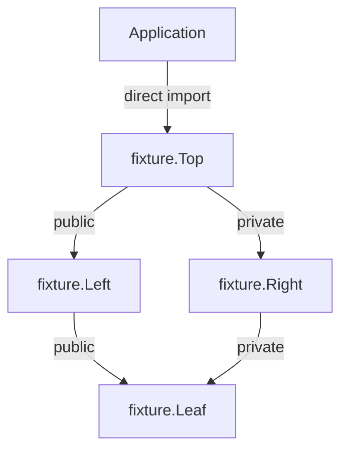

# Offline Linux source packages

The installed `objc3c-build` command builds an explicit local package graph with
the qualified native compiler. It resolves exact package identities, builds each
module once in dependency order, imports locked semantic interfaces, links the
application and runs it. No dependency is fetched or selected by version range.

```sh
cp -R "$OBJC3C_SDK_ROOT/share/objc3c/examples/packages" ./packages
objc3c-build --workspace ./packages/workspace.json \
  --output-dir ./package-build --optimization O2
```

The repository command is equivalent:

```sh
npm run objc3c -- build-packages --workspace ./packages/workspace.json \
  --output-dir ./package-build --optimization O2
```

Select an installed SDK with `OBJC3C_SDK_ROOT` or `--sdk-root`. The SDK is verified
before and after building. Sources and output must be outside that immutable SDK.
Output may live under the workspace, such as `packages/build`, but must be
separate from every package/application source root, including unused packages.
The installed example is copied to an editable workspace above.

## Workspace and package contracts

A workspace uses `schema: "objc3c.source-workspace.v4"`, a `packages` array of
relative package-manifest paths, and an `application` object. The application
specifies a relative `root`, relative `source`, explicit `language`, `standard`,
`ownership`, and `dependencies`.

Each package manifest uses `schema: "objc3c.source-package.v4"`, a canonical
module `name`, an exact opaque `package` identity, a relative `source`,
`language`, `standard`, `ownership`, `provider_ownership`, and `dependencies`. Its source root is the manifest's directory.
Application and package roots must be separate. Source paths and symbolic links
cannot escape their roots; source directory links are rejected.

Every dependency contains `name`, `package`, and `visibility` (`public` or
`private`). The package identity must match exactly. All edges currently require
the same language, standard and ownership mode. Cross-language imports require explicit adaptation. A closed C ABI provider can
select a different `provider_ownership` through the explicit
[ownership projection contract](linux_ownership_projections.md).
Unknown fields, duplicate modules/edges, unresolved locks and cycles are errors.
Unused declarations are validated, but only the application's dependency closure
is built.

The v4 manifests require every mode field and reject earlier versions. Supported modes are:

| Language        | Standard         | Ownership      | Source suffix         |
| --------------- | ---------------- | -------------- | --------------------- |
| `objective-c`   | `c17`            | `arc` or `mrc` | `.m`, `.objc3`        |
| `objective-c++` | `c++20`, `c++23` | `arc` or `mrc` | `.mm`                 |
| `c++`           | `c++20`, `c++23` | `none`         | `.cpp`, `.cc`, `.cxx` |

Regenerate manifests with explicit modes and rebuild package outputs. The compiler
interface identity must reproduce the requested language, standard, ownership and
runtime. Objective-C modes use source-directed imports; plain C++ uses the locked
imports supplied by its manifest.

Native semantic imports enforce visibility. A public edge re-exports its module;
a private edge remains available to its declaring module. Physical availability
of a transitive artifact does not expose its declarations to an importer. The
installed diamond example uses a type through two public edges and separately
checks rejection of a private transitive module.



## Reuse and retained records

Compilation reuse checks SDK seal, recipe, command, source contents and directory
membership, dependency locks, native interface contents, Clang depfiles and every
retained output hash. Preserved timestamps do not preserve a cache hit after a
content change. Provider implementation edits rebuild their object; unchanged
semantic interfaces allow importers to reuse compilation. Changed public API
invalidates transitive importers. Linking always refreshes the host's CRT and
system-library selection, then the application executes.

`build-report.json` retains module identities, workspace-manifest hashes, node
inputs/outputs, reuse decisions and the executable hash. A compiler or linker
failure invalidates the pending successful build record. The native compiler's
publication boundary preserves earlier object/interface products on rejected
compilation. Manifest preflight rejection leaves the prior completed record
untouched; its retained manifest hashes identify the source state it describes.

`package-installation.json` v4 records each selected module's full identity,
explicit language/standard/ownership mode, direct
visibility locks and relative object/interface/sidecar paths with content hashes.
Its content identity is reproduced by unchanged builds. The record describes the
build output. The [immutable package workflow](linux_immutable_packages.md)
publishes and installs that inventory for consumers without provider sources.
Remote registries and public module-language syntax remain separate milestones.

Installed qualification covers all eight supported mode combinations at O0/O2,
with 112 builds and 32 rejected package/visibility cases. It verifies cold/warm
builds, a shared diamond leaf,
provider body edits with preserved timestamps, private implementation edits,
damaged objects/interfaces, transitive API changes, wrong package locks and
private visibility rejection. Objective-C++ ARC cases also return an owned record
through the public Leaf/Left/Top chain, copy its strong and weak fields, verify
one final release and observe weak zeroing. The SDK's runtime headers are available
as system includes and participate in content-verified dependencies.
The suite runs outside the checkout with spaces
and quotes in source paths, and is included in SDK packaging and ordinary-user
fresh-distribution archive qualification. Independent mode cases have disjoint
source trees and logs; the standalone qualifier uses two workers by default.
Packaging reserves graph workers within its global compiler-process budget
and reduces the number of other concurrent gates accordingly.
A failed case joins the remaining workers and replaces any prior success receipt
with a failure report.

The [acceptance receipt](../support/linux_explicit_source_graph_acceptance.json) records
the exact shipped archive, implementation hashes, test cases and distribution
results. Its public workflow check also verifies cold/warm compilation reuse
and an identical linked executable digest.

`ownership` always names the consumer interface mode. `provider_ownership` names
the actual object compilation mode and must be explicit for every package. Equal
modes produce an ordinary interface. Different ARC/MRC modes require a closed
provider with no dependencies and emit a provenance-checked projected interface.
The application has no separate provider mode.

Every package requires an `exports` array. Select native root declaration names
or use `["*"]` for the complete supported surface. See the
[public module surface contract](linux_public_module_surfaces.md) for private
type checks and incremental invalidation rules.
